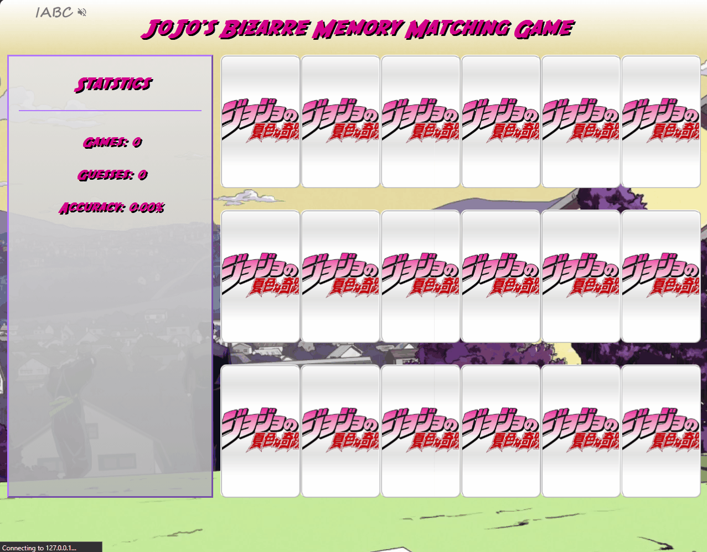
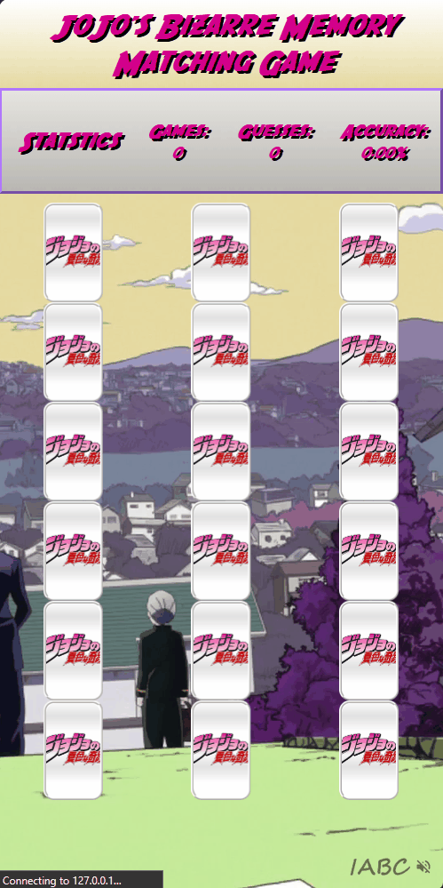
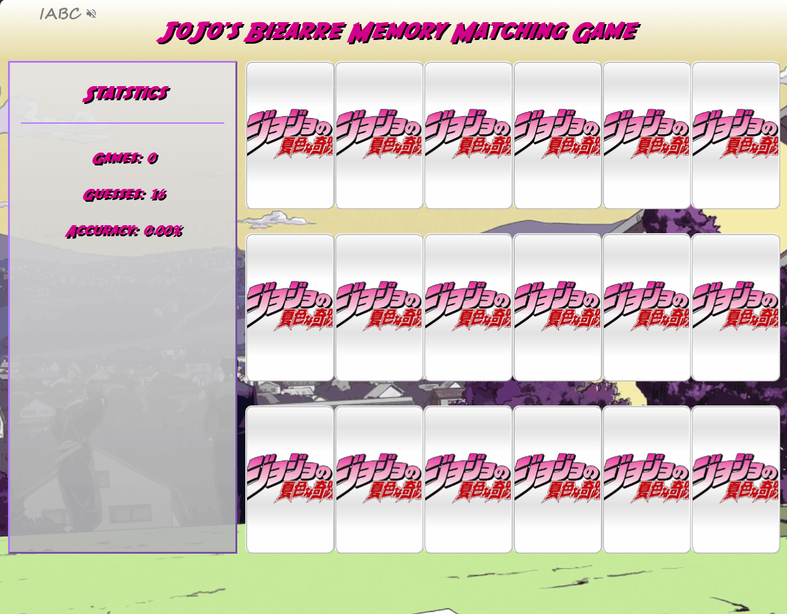
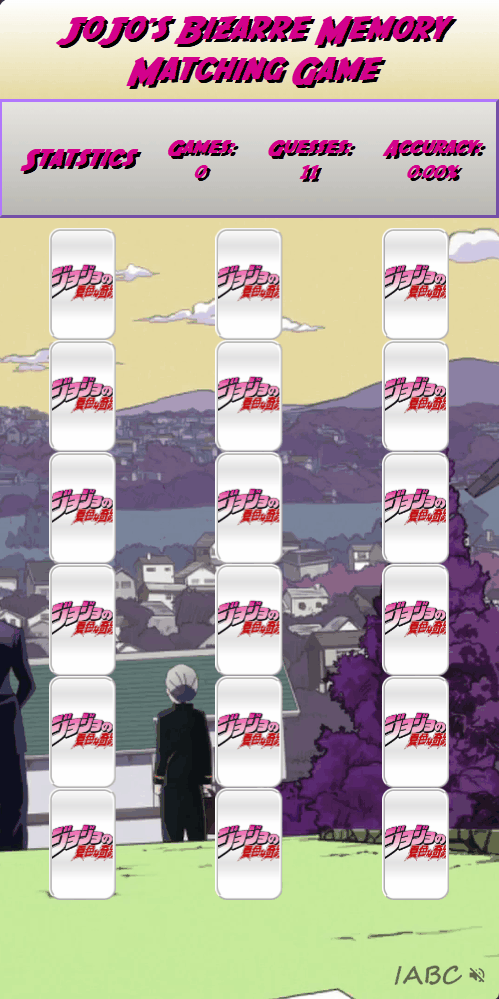
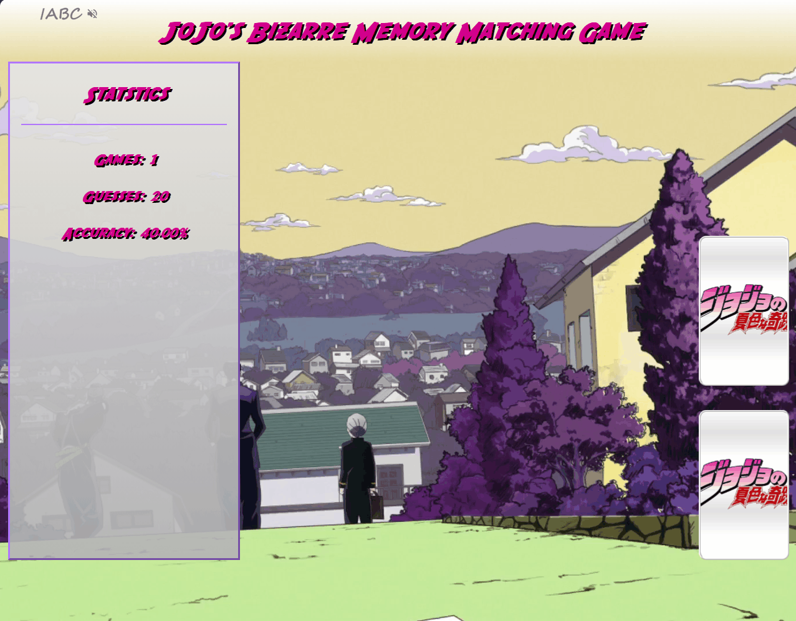
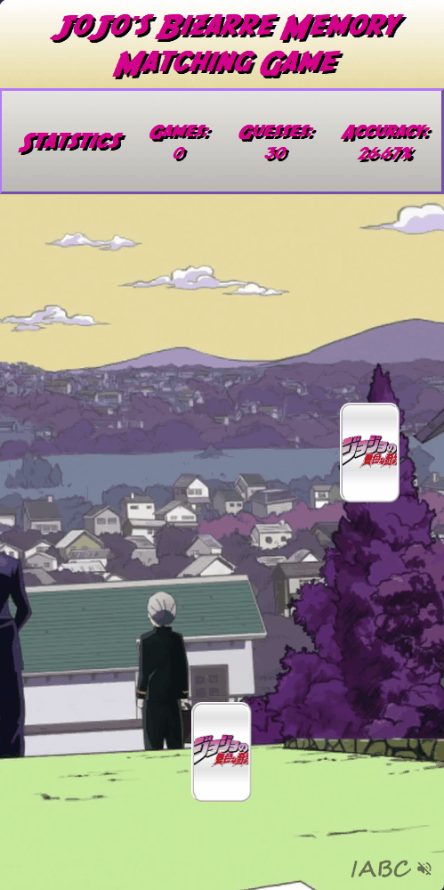

# JoJo's Bizarre Memory Match
A JavaScript based card matching game themed after the anime series, "JoJo's Bizarre Adventure".

## Live Demo Link
Try out the game at: https://coding-christian.github.io/memory-match-game/

## Features
- Players can flip over cards by clicking them with the mouse
- Players can make matches by flipping over a set of two identical cards
- Players can win the game by finding all pairs of matching cards
- Players can start a new game after winning the current game by pressing "Play Again"
- Players can view the number of games played during the current session
- Players can view the number of match attempts made during the current game
- Players can view their accuracy as a percentage of attempted matches that were correct
- Players can change the font of the game between a custom font and the default sans-serif font of their browser
- Players can toggle game audio on and off

## Previews
### Starting a Game
#### Landscape


#### Portrait


### Making a Match
#### Landscape

#### Portrait


### Ending a Game
#### Landscape

#### Portrait


## Installation
### System Requirements
- None
### Getting Started
1. Clone this repository into the desired directory
```
git clone https://github.com/Coding-Christian/memory-match-game
```
2. Navigate to the root of the cloned repository
```
cd memory-match-game
```
3. Open the the file `index.html` in your preferred web browser
```
start /index.html
```
